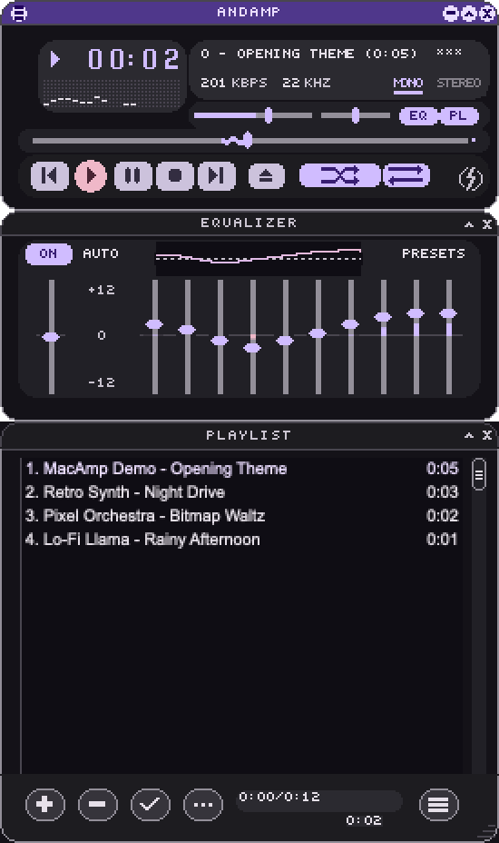
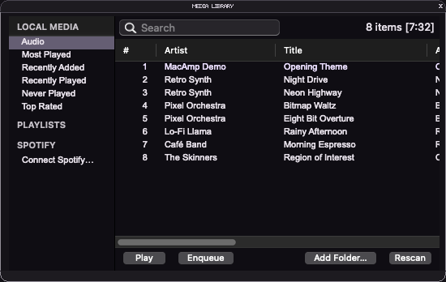

# MacAmp

A native macOS player that recreates the classic Winamp 2.x interface and loads classic skins (`.wsz`).



Plays MP3, AAC/M4A, ALAC, FLAC, Ogg Vorbis, Opus, WAV and AIFF through Core Audio, plus
Shoutcast/Icecast radio streams (MP3/AAC).

**[Download](https://github.com/andrehickmann/macamp/releases/latest/download/MacAmp.zip)** · [Website](https://andrehickmann.github.io/macamp/) · macOS 14+, Apple Silicon and Intel



## Install

Unzip `MacAmp.zip` from the [latest release](https://github.com/andrehickmann/macamp/releases/latest) and move
`MacAmp.app` to Applications. The app is ad-hoc signed, not notarized: if macOS blocks the first launch, click
"Open Anyway" in System Settings › Privacy & Security, or run
`xattr -dr com.apple.quarantine /Applications/MacAmp.app`.

## Skins

MacAmp ships with three skins: AndAmp Dark (the default), Light and Spot by [Mattix](https://mattix.nl) from
[AndAmp](https://github.com/mattijsf/andamp), licensed under [CC BY 4.0](https://creativecommons.org/licenses/by/4.0/).

Switch skins in File › Skins or the right-click menu. Any classic `.wsz` file or unpacked skin folder can be added
there, dropped onto a window or opened from Finder; MacAmp copies it to `~/Library/Application Support/MacAmp/Skins`
("Show Skins Folder"), where it can also be removed. Thousands more are in the
[Winamp Skin Museum](https://skins.webamp.org/).

## Run from source

```bash
swift run MacAmp          # development
scripts/bundle.sh         # builds universal .build/MacAmp.app (ad-hoc signed) and .build/MacAmp.zip
```

Bundled skins live in `Resources/Skins` (credits in `CREDITS.md` there); a user skin with the same name wins.

Audio files, folders and `.m3u`/`.pls` playlists can be passed as arguments, dropped onto a window,
or opened with `L` / the eject button. Dropping onto the playlist appends instead of replacing.

Development options (passed as user defaults):

- `-skinPath <path>` – use this skin for one run
- `-snapshot <out.png>` – render all windows to `out-main.png`, `out-equalizer.png`, `out-playlist.png` and quit
- `-snapshotDelay <seconds>` – wait longer before the snapshot (default 1.5)
- `-mainShade YES`, `-equalizerShade YES`, `-playlistShade YES` – start in shade mode
- `-libraryFolder <path>` – add a folder to the media library and scan it

## Features

- Main window, equalizer and playlist editor with shade modes, double size and `region.txt` shapes
- Three bundled skins plus any classic `.wsz` skin, switchable from the Skins menu
- Windows snap to each other and to screen edges; dragging the main window moves docked windows
- 10-band equalizer with preamp, presets and per-file "Auto" curves
- Playlist: multi-select, drag to reorder, sort/reverse/randomize, remove missing, `.m3u` save/load, resize
- Internet radio: stream titles from ICY metadata, `.pls`/`.m3u` station links, equalizer and analyzer included
- Media library (`gen.bmp` frame): watched folders, tag scan, search, smart views (most/recently played,
  recently added, never played, top rated), ratings, play counts, saved playlists, drag to playlist
- Spotify (experimental; Premium and your own Spotify Client ID required, see [Spotify setup](#spotify-setup)): connect from the library or File menu, browse Liked Songs, playlists and
  search; Spotify tracks join the playlist and play in MacAmp itself (a Spotify Connect device named "MacAmp",
  no Spotify app needed), with the spectrum analyzer fed from the system audio (macOS 14.2+, asks for permission);
  add tracks to Liked Songs or your own Spotify playlists from the context menu in the library or playlist editor,
  or by dragging them onto a playlist in the library sidebar
- Sonos (`⌥R`, Rooms window): see what each room plays, group rooms, set group and room volume, and choose a room
  as MacAmp's output; Spotify tracks and radio streams from the playlist then play on the speakers without the
  Spotify app. For Spotify, click Connect Sonos once (Spotify must be set up in the Sonos app; start a song in
  Spotify on your phone first so MacAmp can tell your account from others in a family plan)
- Artist window (`⌥A`): cover, genres, Wikipedia intro, albums and an artist radio for the Spotify track that plays
- Spectrum analyzer, media keys and Control Center "Now Playing"
- Settings, playlist and window positions persist across launches

## Spotify setup

Spotify limits apps in development mode to five allowlisted users, so register your own app once:

1. Create an app at [developer.spotify.com/dashboard](https://developer.spotify.com/dashboard) (needs Premium).
2. Redirect URI: `macamp://callback`; APIs: Web API and Web Playback SDK.
3. In MacAmp choose File › Spotify Client ID…, paste the app's Client ID, then File › Connect Spotify….

## Keys

`Z` previous · `X` play · `C` pause · `V` stop · `B` next · `L` open · `R` repeat · `S` shuffle ·
`←/→` seek 5 s · `↑/↓` volume · `⌥G` equalizer · `⌥E` playlist · `⌥L` media library · `⌥R` rooms · `⌥A` artist · `⌘L` open URL ·
`⌃W` shade · `⌃D` double size

In the playlist: `⌫` remove, `↩` play, `↑/↓` select, `⌘A` select all.

## Release

```bash
scripts/bundle.sh
gh release create v0.1.0 .build/MacAmp.zip --generate-notes
```

Bump `CFBundleShortVersionString` in `Resources/Info.plist` first. The website lives in `docs/` (GitHub Pages, `main` branch, `/docs`).

## License

[MIT](LICENSE). MacAmp is an independent project and is not affiliated with or endorsed by Winamp, Nullsoft or
Llama Group. Winamp is a trademark of its respective owner. Skins are the work of their respective authors;
the bundled AndAmp skins are licensed under CC BY 4.0 (see `Resources/Skins/CREDITS.md`).
